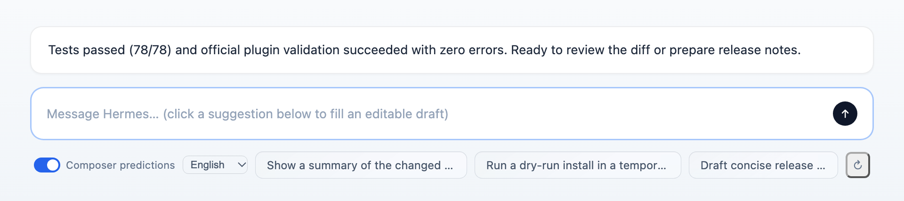

# Hermes Composer Predictions

Three next-step prompts for Hermes Desktop. Review a suggestion, fill an editable draft, and send only when you choose.

[简体中文](README.zh-CN.md)



## What it does

- Requests three next-step prompts after an assistant response completes, when opening an eligible session, or on manual refresh `↻`. Invalid or duplicate candidates are filtered, so fewer may appear.
- Uses recent visible conversation text; generation requires the latest visible message to be from the assistant.
- Clicking fills an editable draft and **never sends**. When public `getDraft` exists, empty/whitespace-only or matching drafts fill immediately. For a different nonempty draft, the first click leaves it untouched and shows an informational prompt: click the **same suggestion again within 5 seconds** to replace it. Another chip, changed draft, expiry, session/profile/connection switch, disable, regeneration, or unload resets confirmation. If `getDraft` is absent, the old-host fallback directly replaces the draft; save existing text first. A failed draft read does not overwrite.
- Persists the feature switch and interface language (`en` by default / `zh-CN`). Switching interface language makes no new generation request. Suggestion language follows the conversation.
- Preserves the approved B glass chips: `8px` corners, `0.5px` border, `blur(12px) saturate(115%)`, `38%` translucent background, full-prompt tooltips, and localized failure/manual retry.

## Install

Use a local checkout. Node.js **22.13+** is required for installer/development commands.

```sh
node scripts/install.mjs --home /path/to/hermes-home --dry-run
node scripts/install.mjs --home /path/to/hermes-home
```

Without `--home`, the installer uses `HERMES_HOME`, then `~/.hermes`. Choose the home for your desktop profile. Target: `desktop-plugins/conversation-guidance/plugin.js`. Different existing files require explicit `--force` and receive a backup. Runtime ID remains `conversation-guidance` to preserve settings.

Manual installation: copy the root `plugin.js` to that target. No runtime dependencies or build are needed: Hermes supplies SDK/React. Desktop normally hot-reloads; fallback: **Reload desktop plugins** in the command palette.

### Catalog package

`plugin.yaml` and `desktop/plugin.js` are the official directory-plugin layout. Root `plugin.js` is the **sole source**; `npm run build` creates the byte-identical catalog copy; `npm run check` refuses drift. Both installation paths use the same code. No self-updater, extra backend tools/hooks/middleware, required environment variables, binary bundles, or external runtime imports are shipped. The only runtime imports are `@hermes/plugin-sdk`, `react`, and `react/jsx-runtime`.

The [catalog entry draft](docs/catalog-entry.draft.yaml) still needs an approved public repository, maintainer, final public 40-character commit SHA, and real privacy-reviewed UI screenshots. It is **not an installed/approved listing**. After publication approval, validate the exact pinned tree with `hermes plugins validate /path/to/checkout --install-deps`; submit only the entry YAML to `plugin-catalog/`.

### Uninstall

```sh
node scripts/install.mjs --home /path/to/hermes-home --uninstall --dry-run
node scripts/install.mjs --home /path/to/hermes-home --uninstall
```

Removes only an unmodified file owned by this installer; edited files are refused even with `--force`. Unrelated files/preferences remain. Remove a manual copy manually after inspecting it. For CLI installs, use `hermes plugins remove conversation-guidance` instead; do not mix installation ownership.

## Two compatibility layers

1. **Bottom chips:** any Hermes Desktop exposing public `host.composer.setDraft(sessionId, text)` can use click-to-fill (with a working gateway/`llm.oneshot`). Missing `setDraft` disables buttons with an upgrade hint. `getDraft` protection is optional as described above. No private DOM/event fallback.
2. **Native gray preview:** requires Hermes Desktop containing [PR #151206](https://github.com/NousResearch/hermes-agent/pull/151206). The host provides **Tab** cycle / **→** accept into draft / **Esc** hide, never send. The plugin publishes only with nonempty `sessionId`, `profile`, and `connectionId`, saves the exact returned opaque handle, and clears that same object on regeneration, disable, identity change, or unload. A `null` return does not discard an owned handle or affect clickable chips. Hosts without `setPredictions` retain all chip behavior.

Manifest/catalog `requires_hermes: ">=0.23.0"` is a conservative released CLI/catalog baseline, **not** a claim that that version includes PR #151206 or the earliest possible Desktop support. Runtime APIs determine Desktop capability. See [compatibility](docs/compatibility.md).

## Model, privacy, cost, and rule 13 disclosure

After a completed assistant turn (also eligible session open/manual retry), the plugin reads current-session history using the host gateway, selects the **latest six nonempty visible user/assistant messages**, and caps their text at **12,000 characters**. It makes **one auxiliary `llm.oneshot` request per generation**, `task: 'composer_predictions'`, with the active `session_id`/profile and a **150000ms** timeout. Routing uses the host's configured auxiliary/session/default model; the configured model provider may receive this context and charge for it. Instructions/formatting are outside the text cap. Filtered system/tool/hidden reasoning is excluded; visible secrets are **not redacted**.

The plugin does **not** write conversation history, read credential files or credential stores, add external third-party telemetry, execute shell commands at runtime, or run background processes. Clicking or accepting a suggestion writes **only the draft**, never automatically sends. Optional `getDraft` reads the current composer draft locally for replacement confirmation; it is not added to the model request. Only locale and enabled state persist through namespaced `ctx.storage`; candidates/handles/confirmation are in memory. The local installer writes only the explicitly selected plugin file, receipt, and conflict backups. Disable prevents new generation and suppresses stale results, but cannot cancel already issued calls or their cost. Host diagnostics/provider retention are outside this plugin's control.

## Development and verification

```sh
npm ci --ignore-scripts
npm run build
npm run check
```

Dependencies are development/test tooling only, not vendored or shipped binaries. Tests run real React effects with a mocked SDK and real sandbox installer commands. They do not establish live appearance, native keyboard/IME correctness, or remote CI success. See [validation evidence](docs/validation.md), [release checklist](docs/release-checklist.md), [contributing](CONTRIBUTING.md), and [changelog](CHANGELOG.md).

## License

MIT. Copyright (c) 2026 hermes-composer-predictions contributors.
