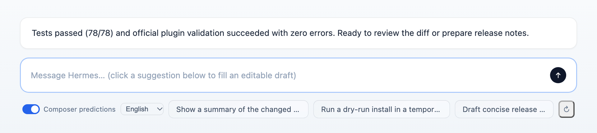

# Hermes Composer Predictions

为 Hermes Desktop 提供三条下一步提示。先查看建议，填入可编辑草稿，由你决定是否发送。

[English](README.md)



## 功能

- 助手回复完成、打开符合条件的会话或手动刷新 `↻` 时，请求三条下一步提示。无效或重复候选会被过滤，因此实际可能少于三条。最后一条可见消息必须来自助手。
- 点击建议仅填入可编辑草稿，**绝不自动发送**。若宿主提供公开 `getDraft`：空白草稿或去除首尾空白后与建议相同的草稿直接填入；若草稿已有其他非空内容，首次点击不覆盖并给出提示，须在 **5 秒内再次点击同一建议**才替换。换点另一条、草稿内容变化、过期、切换会话/profile/connection、禁用、重新生成或卸载组件均重置确认。旧宿主无 `getDraft` 时保留直接替换行为，请先保存已有文字。读取草稿失败不会覆盖。
- 功能开关及界面语言持久化：默认英文，可选简体中文。切换界面语言不重发生成请求；建议语言跟随对话。
- 保留已定稿 B 方案玻璃芯片：`8px` 圆角、`0.5px` 边框、`blur(12px) saturate(115%)`、`38%` 透明背景、完整文本提示，以及本地化失败提示和手动重试。

## 安装

使用本仓库本地副本。安装脚本和开发命令要求 Node.js **22.13+**。

```sh
node scripts/install.mjs --home /path/to/hermes-home --dry-run
node scripts/install.mjs --home /path/to/hermes-home
```

未指定 `--home` 时依次使用 `HERMES_HOME`、`~/.hermes`。请选择桌面档案实际使用的 home。目标为 `desktop-plugins/conversation-guidance/plugin.js`。不同内容的已有文件须显式 `--force` 才覆盖并生成备份。内部 ID 保持 `conversation-guidance`，保留设置命名空间。

手动安装可直接复制根目录 `plugin.js` 至该目标。无需构建或安装运行时依赖，SDK/React 由宿主提供。通常自动热重载；必要时在命令面板执行 **Reload desktop plugins**。

### 官方目录包

`plugin.yaml` 与 `desktop/plugin.js` 是官方目录插件结构。根目录 `plugin.js` 是**唯一源码**，`npm run build` 生成逐字节相同的目录副本，`npm run check` 阻止漂移。两条安装路径使用同一代码。不含自更新、额外后端 tools/hooks/middleware、所需环境变量、二进制包或外部运行时导入；仅导入 `@hermes/plugin-sdk`、`react`、`react/jsx-runtime`。

[目录 YAML 草案](docs/catalog-entry.draft.yaml)仍需填入经批准的公开仓库、维护者、最终公开提交的完整 40 位 SHA，以及真实且检查过隐私的界面截图；**不代表已获准上架**。批准公开后，在最终固定提交上运行 `hermes plugins validate /path/to/checkout --install-deps`，仅将目录条目 YAML 提交至官方 `plugin-catalog/`。

### 卸载

```sh
node scripts/install.mjs --home /path/to/hermes-home --uninstall --dry-run
node scripts/install.mjs --home /path/to/hermes-home --uninstall
```

仅删除本安装器拥有且未修改的文件，即使 `--force` 也拒绝删除已编辑文件。保留其他文件及偏好设置。手动复制的文件检查后手动删除。CLI 安装则使用 `hermes plugins remove conversation-guidance`，不要混用安装所有权。

## 两层兼容性

1. **底部芯片：** 任何提供公开 `host.composer.setDraft(sessionId, text)` 的 Hermes Desktop 均支持点击填入（还需正常网关和 `llm.oneshot`）。缺少 `setDraft` 会禁用按钮并提示升级；`getDraft` 保护按上文可选启用。无私有 DOM/事件回退。
2. **输入框原生灰字预览：** 需要包含 [PR #151206](https://github.com/NousResearch/hermes-agent/pull/151206) 的 Hermes Desktop。由宿主实现 **Tab** 切换 / **→** 接受至草稿 / **Esc** 隐藏，绝不发送。插件仅在 `sessionId`、`profile`、`connectionId` 均为非空字符串时发布，保存返回的不透明句柄原对象，在重新生成、禁用、身份切换或卸载时清理同一对象。返回 `null` 不丢失已有待清理句柄，也不影响底部芯片。无 `setPredictions` 的宿主保留完整芯片交互。

Manifest 与目录的 `requires_hermes: ">=0.23.0"` 是保守的已发布 CLI/目录基线，**不是**宣称该版本已含 PR #151206，也不代表最早可用的 Desktop 版本；Desktop 能力通过运行时公开接口判断。详见[兼容性](docs/compatibility.zh-CN.md)。

## 模型、隐私、费用与准入第 13 条披露

助手回合结束后（或打开符合条件的会话/手动重试），通过宿主现有网关读取当前会话历史，仅选取**最近六条非空可见 user/assistant 消息**，文本合计最多 **12,000 字符**。每次生成执行**一次辅助 `llm.oneshot` 请求**，`task: 'composer_predictions'`，传入当前 `session_id`/profile，超时 **150000ms**。模型遵循宿主辅助任务/会话/默认路由；配置的模型提供商会收到上下文并可能收费。指令及格式文本不计入消息文本上限。排除系统、工具及隐藏推理；**可见消息中的秘密不会脱敏**。

插件**不写回会话历史、不读取凭据文件或凭据库、无外部第三方遥测、运行时不执行 shell、不启动后台进程**。点击或接受建议仅写入草稿，绝不自动发送。可选 `getDraft` 仅在本地检查当前草稿以确认替换，不将草稿额外加入模型请求。通过命名空间 `ctx.storage` 仅持久化语言与开关；候选、句柄、确认状态仅存内存。本地安装器仅向选定插件目录写入插件文件、收据及冲突备份。禁用阻止新请求并忽略过期结果，但无法取消已发请求或其费用；宿主诊断和提供商保留政策不由本插件控制。

## 开发与验证

```sh
npm ci --ignore-scripts
npm run build
npm run check
```

依赖仅用于开发测试，不打包第三方二进制。测试使用真实 React effect、模拟 SDK 和真实沙盒安装命令；不能证明真实界面、原生键盘/输入法或远程 CI 已通过。见[验证证据](docs/validation.md)、[发布检查表](docs/release-checklist.zh-CN.md)、[贡献指南](CONTRIBUTING.md)及[变更记录](CHANGELOG.md)。

## 许可证

MIT。Copyright (c) 2026 hermes-composer-predictions contributors.
